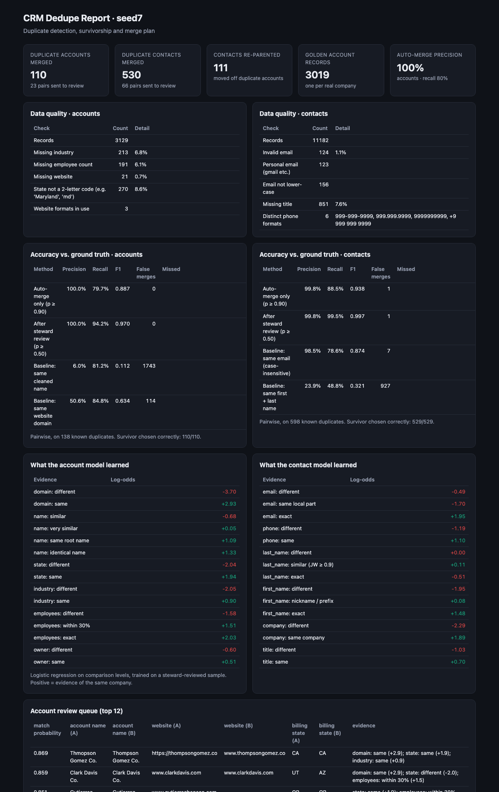
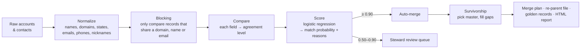

# CRM Dedupe Toolkit

**Finds duplicate accounts and contacts in CRM exports, decides which record survives, and produces merge files a Salesforce admin can act on. Every merge comes with its reasons, and every number is scored against ground truth on a company the model never saw.**



Built on [ledgerly-data](https://github.com/jungmarker/ledgerly-data), a synthetic B2B SaaS company with realistic CRM messiness and a hidden answer key.

## Results (held-out company)

Trained on 400 steward-reviewed pairs from one simulated company (seed 42), evaluated on a different one (seed 7, 3,129 accounts and 11,182 contacts):

| Accounts | Precision | Recall | F1 |
|---|---|---|---|
| **Auto-merge (p ≥ 0.90)** | **100%** | 80% | 0.89 |
| **After steward review of 23 pairs (p 0.50–0.90)** | **100%** | **94%** | **0.97** |
| Baseline: same website domain | 51% | 85% | 0.63 |
| Baseline: same cleaned name | 6% | 81% | 0.11 |

| Contacts | Precision | Recall | F1 |
|---|---|---|---|
| **Auto-merge (p ≥ 0.90)** | **99.8%** | 89% | 0.94 |
| **After steward review of 66 pairs** | **99.8%** | **99.5%** | **0.997** |
| Baseline: same email | 98.5% | 79% | 0.87 |

The surviving record was chosen correctly in **110/110** account merges and **529/529** contact merges.

**Why the baselines fail:** matching on website alone would merge 114 pairs of *different* companies that share a domain pattern (e.g. "Brown Group Holdings" in NJ and "Brown Group Corp." in FL). Matching on name alone is worse. Real duplicates also drift: a different rep creates them, headcount gets refreshed, the website is missing. So no single field is enough, and the model weighs all of them.

## How it works



1. **Normalize.** "The Brown-Ramirez Co." → `brown ramirez`; `https://www.Acme.io/` → `acme.io`; "Maryland" / "md" → `MD`; `(301) 875-7182` / `+1 301 875 7182` → `3018757182`; Bob → Robert.
2. **Blocking.** Comparing every pair of 3,000 accounts means 4.9M comparisons. Blocking on shared keys cuts that to about 2,700 candidates while keeping 99% of true duplicates.
3. **Compare.** Each field becomes a level: domain same / different / missing; name identical / same root / very similar / similar / different; employee count exact / within 30% / different, and so on.
4. **Score.** A logistic regression on those levels, trained on a small labeled sample. The weights are readable: a different domain is −3.7 log-odds, the same state +1.9, an identical name +1.3. Every merge row lists its top reasons.
5. **Cluster.** Union-find, so A=B and B=C merge into one company.
6. **Survivorship.** Accounts: paying customer > churned > prospect, then most opportunities, then oldest. Contacts: primary buyer, then from a lead, then a valid work email, then oldest. Gaps in the master (industry, headcount, website) are filled from its duplicates, and formats are standardized.
7. **Contacts after accounts.** Contacts are matched within the *resolved* company, so a person attached to a duplicate account still matches their twin on the master.

### Why supervised, with a small labeled sample?

I first built an unsupervised Fellegi-Sunter model fitted with EM (the approach behind Splink). It kept converging on the wrong pattern. In CRM data, owner, state and segment are correlated through sales territories, and the domain is derived from the company name. That breaks the model's independence assumption, so EM "discovered" groups like *same name, different company* instead of duplicates.

A steward reviewing 400 pairs takes about an hour. The sample is stratified so most of the review goes to ambiguous pairs, and those labels produced a model that transfers to a different company at 100% auto-merge precision. In a real rollout, the review queue keeps producing labels, so the model improves as it's used.

## Outputs

`crm-dedupe run` writes to `out/`:

| File | What it's for |
|---|---|
| `account_merge_plan.csv` | master_id, duplicate_id, probability, evidence: ready for a Salesforce merge job or Data Loader |
| `account_review_queue.csv` | side-by-side pairs for a steward to approve or reject |
| `contact_merge_plan.csv`, `contact_review_queue.csv` | same for contacts |
| `contact_reparent.csv` | contacts that move from a duplicate account to the surviving one |
| `golden_accounts.csv` | one clean record per real company |
| `metrics.json`, `report.html` | data-quality profile, accuracy vs. truth, model weights, review queue |

## Quickstart

```bash
make setup   # venv + dependencies + Ledgerly generator
make all     # generate two companies → train on one → run on the other → tests
open out/seed7/report.html
```

Run it on your own export with the same column names:

```bash
crm-dedupe run --data path/to/export --out out/mine   # expects raw/accounts.csv and raw/contacts.csv
```

## Tests

16 tests (`pytest`): normalization rules, transitive clustering, model save/load, and an end-to-end holdout test. The holdout test trains on one company, runs on another, and checks auto-merge precision ≥ 98%, recall after review ≥ 90%, a beaten domain baseline, and merge-plan integrity (masters never merged away, customers always survive, contacts only move onto masters).

## Stack

Python · pandas · RapidFuzz (Jaro-Winkler, token-set similarity) · scikit-learn · GitHub Actions. Models are stored as plain JSON coefficients, with no pickles.
